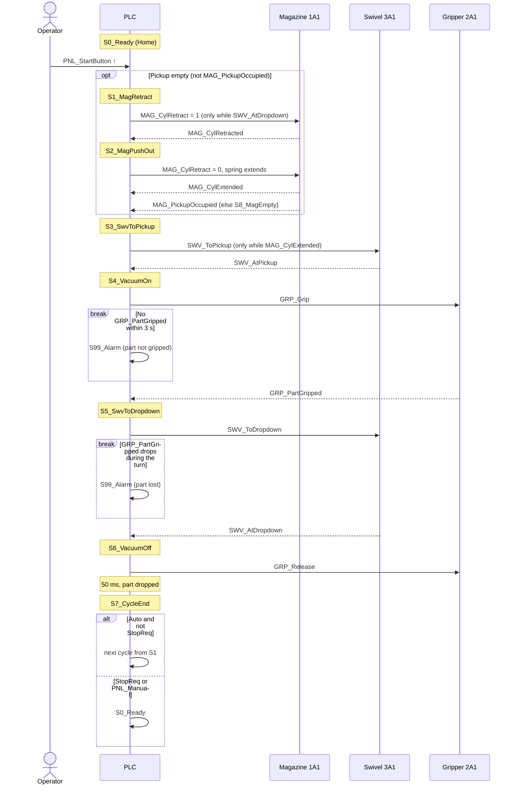
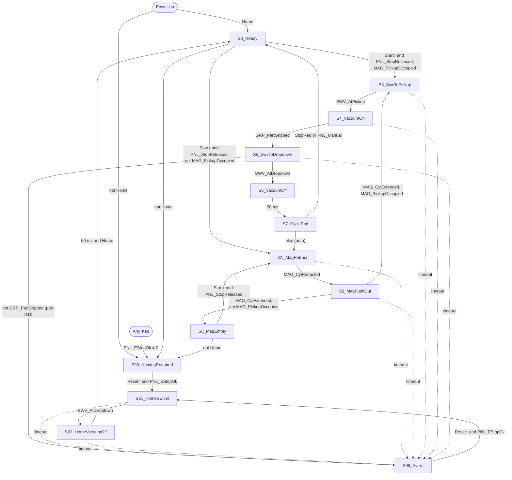
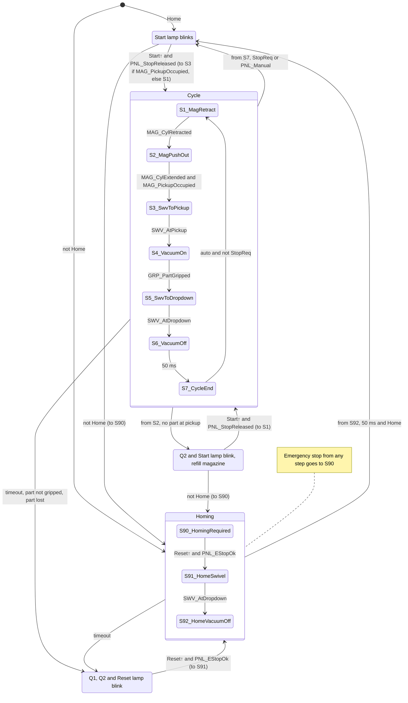

# Magazine and swivel station (Detailimagasin ja pöördsilinder)

Status: draft

## 1. Modules

| Module | Name | Local name | Groups |
|---|---|---|---|
| PNL | Control panel | Juhtpaneel | 0 |
| MAG | Magazine | Detailimagasin | 1 |
| GRP | Vacuum gripper | | 2 |
| SWV | Swivel cylinder | Pöördsilinder | 3 |

## 2. Components

| Tag | Name | Local name | Notes |
|---|---|---|---|
| ? | PLC | | Model ? |
| PNL2 | Control panel (Festo I/O) | Juhtpaneel | 8 I, 8 O, labeled from the panel side: buttons on `O`, lamps on `I`; PLC connection 1 |
| XMA2 | Terminal block | Klemmiplokk | 8 I, 8 O, labeled from the PLC side: sensors on `I`, coils on `O`; PLC connection 2 |
| 0V1 | Valve island | Ventiilisaar | Air is always on |
| 0P1 | Pressure gauge | Manomeeter | |

## 3. Pneumatics

| Actuator | Name | Valve | Valve type | Coils | Coils off |
|---|---|---|---|---|---|
| 1A1 | Magazine cylinder: pushes the next part to pickup | 1V1 | 5/2 single solenoid, spring return | 1Y1A | extends |
| 2A1 | Vacuum gripper | 2V1 | ? | 2Y1A, 2Y1B | vacuum not held |
| 3A1 | Swivel cylinder | 3V1 | 5/3 closed centre | 3Y1A, 3Y1B | stops where it is |

## 4. I/O list

| Tag | Address | Direction | Symbol | Description |
|---|---|---|---|---|
| 0S1 | PNL2.O0 | input | `PNL_StartButton` | Start button: 1 = pressed |
| 0S2 | PNL2.O1 | input | `PNL_StopReleased` | Stop button, NC: 1 = released |
| 0S3 | PNL2.O2 | input | `PNL_Manual` | Key switch: 1 = manual, 0 = auto |
| 0S4 | PNL2.O3 | input | `PNL_ResetButton` | Reset button: 1 = pressed |
| 0S5 | ? | input | `PNL_EStopOk` | Emergency stop, NC: 1 = released |
| 0H1 | PNL2.I0 | output | `PNL_StartLamp` | Start button lamp: 1 = on |
| 0H2 | PNL2.I1 | output | `PNL_ResetLamp` | Reset button lamp: 1 = on |
| 0H3 | PNL2.I2 | output | `PNL_LampQ1` | Indicator lamp `Q1`: 1 = on |
| 0H4 | PNL2.I3 | output | `PNL_LampQ2` | Indicator lamp `Q2`: 1 = on |
| 1S1 | XMA2.I1 | input | `MAG_CylExtended` | Magazine cylinder: 1 = extended |
| 1S2 | XMA2.I2 | input | `MAG_CylRetracted` | Magazine cylinder: 1 = retracted |
| 2S1 | XMA2.I3 | input | `GRP_PartGripped` | Gripper low pressure sensor: 1 = vacuum reached, part gripped |
| 3S1 | XMA2.I4 | input | `SWV_AtPickup` | Swivel: 1 = at pickup |
| 3S2 | XMA2.I5 | input | `SWV_AtDropdown` | Swivel: 1 = at dropdown |
| 1S3 | XMA2.I6 | input | `MAG_PickupOccupied` | Pickup position: 1 = part present |
| 1Y1A | XMA2.O0 | output | `MAG_CylRetract` | Magazine cylinder valve: 1 = retract |
| 2Y1A | XMA2.O1 | output | `GRP_Grip` | Gripper valve: 1 = vacuum on |
| 2Y1B | XMA2.O2 | output | `GRP_Release` | Gripper valve: 1 = vacuum off |
| 3Y1A | XMA2.O3 | output | `SWV_ToPickup` | Swivel valve: 1 = turn to pickup |
| 3Y1B | XMA2.O4 | output | `SWV_ToDropdown` | Swivel valve: 1 = turn to dropdown |

## 5. Control

- Home = `MAG_CylExtended` and `SWV_AtDropdown`.
- Power-up: Home → S0, else S90.
- Emergency stop (`PNL_EStopOk` = 0), from any step → S90: the PLC switches all coils off.
- Stop (`PNL_StopReleased` = 0) sets StopReq: the cycle finishes, then S0. S0 and S8 clear StopReq.
- Auto (`PNL_Manual` = 0) repeats the cycle; manual runs one cycle per Start.

| Output | Only while | Prevents |
|---|---|---|
| `MAG_CylRetract` | `SWV_AtDropdown` | Magazine cylinder hitting the swivel at pickup |
| `SWV_ToPickup` | `MAG_CylExtended` | Magazine cylinder hitting the swivel at pickup |

| Step | Outputs on | Next when | Timeout → S99 |
|---|---|---|---|
| `S90_HomingRequired` | `PNL_LampQ1` (blink if `PNL_EStopOk`), `PNL_LampQ2` (blink if `PNL_EStopOk`), `PNL_ResetLamp` (blink if `PNL_EStopOk`) | Reset↑ and `PNL_EStopOk` → S91 | — |
| `S91_HomeSwivel` | `SWV_ToDropdown`, `PNL_LampQ1`, `PNL_LampQ2`, `PNL_ResetLamp` | `SWV_AtDropdown` → S92 | 3 s |
| `S92_HomeVacuumOff` | `GRP_Release`, `SWV_ToDropdown`, `PNL_LampQ1`, `PNL_LampQ2`, `PNL_ResetLamp` | 50 ms and Home → S0 | 3 s |
| `S0_Ready` | `PNL_StartLamp` (blink) | not Home → S90; Start↑ and `PNL_StopReleased` → S3 if `MAG_PickupOccupied`, else S1 | — |
| `S1_MagRetract` | `MAG_CylRetract`, `PNL_StartLamp` | `MAG_CylRetracted` → S2 | 3 s |
| `S2_MagPushOut` | `PNL_StartLamp` | `MAG_CylExtended` → S3 if `MAG_PickupOccupied`, else S8 | 3 s |
| `S3_SwvToPickup` | `SWV_ToPickup`, `PNL_StartLamp` | `SWV_AtPickup` → S4 | 3 s |
| `S4_VacuumOn` | `GRP_Grip`, `SWV_ToPickup`, `PNL_StartLamp` | `GRP_PartGripped` → S5 | 3 s (part not gripped) |
| `S5_SwvToDropdown` | `GRP_Grip`, `SWV_ToDropdown`, `PNL_StartLamp` | not `GRP_PartGripped` → S99 (part lost); `SWV_AtDropdown` → S6 | 3 s |
| `S6_VacuumOff` | `GRP_Release`, `SWV_ToDropdown`, `PNL_StartLamp` | 50 ms → S7 | — |
| `S7_CycleEnd` | `PNL_StartLamp` | StopReq or `PNL_Manual` → S0, else S1 | — |
| `S8_MagEmpty` | `PNL_LampQ2` (blink), `PNL_StartLamp` (blink) | not Home → S90; Start↑ and `PNL_StopReleased` → S1 | — |
| `S99_Alarm` | `PNL_LampQ1` (blink), `PNL_LampQ2` (blink), `PNL_ResetLamp` (blink) | Reset↑ and `PNL_EStopOk` → S91 | — |

## 6. Diagrams

### 6.1 Displacement-step diagram

Actuator positions and part location at the end of each step of a normal cycle. Bold marks a change.

| | S0 | S1 | S2 | S3 | S4 | S5 | S6 | S7 |
|---|---|---|---|---|---|---|---|---|
| 1A1 Magazine cylinder | extended | **retracted** | **extended** | extended | extended | extended | extended | extended |
| 3A1 Swivel | dropdown | dropdown | dropdown | **pickup** | pickup | **dropdown** | dropdown | dropdown |
| 2A1 Gripper vacuum | off | off | off | off | **on** | on | **off** | off |
| Part | in magazine | in magazine | **at pickup** | at pickup | **gripped** | gripped | **dropped** | dropped |
| Step ends on | Start↑ | `MAG_CylRetracted` | `MAG_CylExtended` | `SWV_AtPickup` | `GRP_PartGripped` | `SWV_AtDropdown` | 50 ms | StopReq, `PNL_Manual` or auto |

### 6.2 Normal cycle sequence

One cycle in auto mode: each PLC command and the sensor that confirms it. `break` blocks are faults that end the cycle in S99.

### 6.3 Step flowchart

Every step and transition from section 5. Dashed arrows are step timeouts (3 s). Emergency stop from any step goes to S90.

### 6.4 Operating modes

The same steps grouped into modes. Labels on arrows between modes name the step they leave from or enter at.

